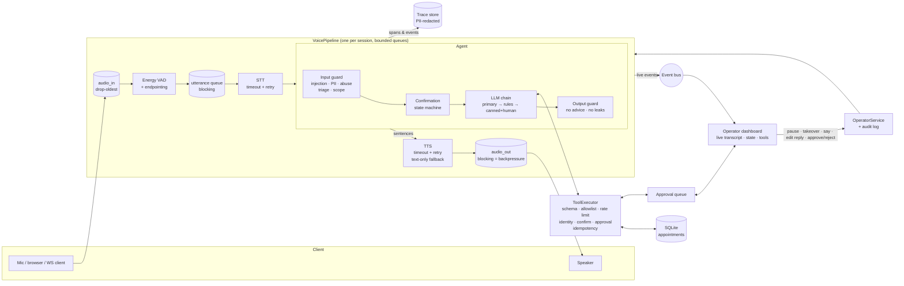

# offline-voice-agent

**A fully local, privacy-preserving voice agent for a clinic front desk.** It books, reschedules and cancels appointments, answers hours/insurance FAQs, and escalates to a human, all without a single audio byte, transcript or prompt leaving the machine. The interesting part is not the demo. It is the production scaffolding around it: a bounded async streaming pipeline with barge-in, a layered safety design that does not trust the model, a 65-scenario eval suite that gates CI, and a live operator console with human-in-the-loop controls.

```
caller audio ─▶ VAD ─▶ STT ─▶ input guardrails ─▶ LLM + tools ─▶ output guardrails ─▶ TTS ─▶ caller
                                      │                  │
                                      ▼                  ▼
                         tool-permission layer ─▶ SQLite appointment backend
                                      │
                    traces · live dashboard · operator approvals / takeover / edit-before-speak
```

* Python 3.12, FastAPI + WebSocket, SQLite, pytest. **134 tests, all offline.**
* Real local backends are optional adapters: `faster-whisper` (STT), Ollama (LLM), macOS `say` or Piper (TTS).
* Deterministic mock adapters (synthetic-audio STT, rule-based tool-calling LLM, silent TTS) sit behind the *same interfaces*, so tests, CI, the simulator and the benchmark run with no microphone and no model downloads.

---

## Architecture



### Per-turn flow (and where time goes)

1. **VAD** (energy + hangover endpointing) cuts the mic stream into utterances. Speech-start while the agent is talking triggers **barge-in**.
2. **STT** transcribes (timeout, retry, reprompt, human handoff after repeated failures).
3. **Input guardrails** run *before* the LLM sees anything. Blocked text is never added to the model's context.
4. **Agent** streams the LLM; each completed sentence passes the **output guardrail** and is handed to TTS immediately (time-to-first-audio does not wait for the full reply). Tool calls go through the **ToolExecutor**.
5. **TTS** streams audio chunks into a bounded queue. A slow client therefore slows TTS, which slows the LLM stream (backpressure), instead of growing memory.
6. Every stage emits a **span** (`vad, stt, guardrail, llm, tool, tts`) into a PII-redacted trace row and onto the live event bus.

---

## The three pillars, mapped to code

### 1. Reliability and scalability

| Capability | Where | Proven by |
|---|---|---|
| Async streaming pipeline, **bounded queues + backpressure** (mic queue drops *oldest*; utterance and audio-out queues block) | `pipeline.py` | `test_audio_input_queue_is_bounded_and_drops_oldest`, `test_slow_client_applies_backpressure_to_tts` |
| **Per-stage timeouts and retries** with backoff | `resilience.py`, `Settings.*_timeout_s / *_retries` | `test_call_with_retries_and_breaker_primitives`, `test_stt_retry_recovers_from_transient_failure` |
| **Fallback chain**: primary LLM → rule-based degraded mode → canned safe reply → human handoff | `adapters/resilient.py`, `agent._llm_failure` | `test_primary_llm_failure_degrades_to_rule_based_backend`, `test_llm_timeout_falls_back_to_canned_reply_and_human_handoff` |
| **Circuit breaker** per backend (stops hammering a dead model) | `resilience.CircuitBreaker` | `test_circuit_breaker_opens_after_repeated_llm_failures` |
| **Graceful degradation**: TTS failure becomes text-only, turn crash is contained, session survives | `pipeline._speak`, `_run_turn` | `test_tts_failure_degrades_to_text_only_reply`, `test_unexpected_agent_crash_is_contained` |
| **Session state machine** (connecting, idle, listening, thinking, speaking, paused, takeover, handoff, disconnected, closed) with validated transitions | `context.py` | `test_state_machine_*`, `test_state_transitions_follow_a_turn` |
| **Recovery on WebSocket reconnect** (resume token, conversation + pending confirmation + operator pause restored, undelivered reply replayed) | `session.py`, `server.py` | `test_reconnect_restores_conversation_state_including_pending_confirmation`, `test_websocket_reconnect_resumes_session_state` |
| **Concurrent sessions and resource limits** (max sessions, 1013 on overload, idle and grace reaper, max turns, max frame size, max utterance length) | `session.SessionManager`, `Settings` | `test_capacity_limit_*`, `test_reaper_*`, `test_turn_limit_is_enforced` |
| **Idempotent tool calls** (explicit or derived keys persisted in SQLite; retries replay instead of double-booking) | `executor.py`, `backend/store.py` | `test_idempotency_key_replays_without_double_booking` |
| Double-booking is impossible by construction (partial unique index) | `backend/db.py` | `test_book_and_double_booking_prevented_by_unique_index` |
| **Health endpoints** (`/health` with breaker/db/capacity state, `/ready`), **Dockerfile** with HEALTHCHECK | `server.py`, `Dockerfile` | `test_health_endpoint_*` |
| **Benchmark**: N concurrent sessions, per-stage p50/p95, time-to-first-audio | `bench.py` | `test_benchmark_reports_stage_percentiles` |

### 2. Security

Safety is enforced by **deterministic code outside the model**. The LLM is treated as an untrusted component: if it is jailbroken, the layers below still hold (and the eval suite proves that with a deliberately compromised `RogueLLM`).

| Layer | What it does | Where |
|---|---|---|
| **Input guard** | prompt-injection/jailbreak detection (incl. leetspeak and tool-spoofing phrases), emergency triage, threat/abuse/profanity handling, "don't tell me your SSN/card" detection (Luhn), cross-patient requests, medical-advice requests | `guardrails/input_guard.py` |
| **PII redaction** | phone, email, SSN, card, DOB, known names; applied to logs, traces, dashboard, approval args, audit log | `guardrails/pii.py`, `observability/logging.py` |
| **Tool-permission layer** | allowlist, pydantic schemas with `extra=forbid`, per-session rate limits (calls and mutations), session identity binding, appointment ownership check | `guardrails/permissions.py`, `backend/tools.py`, `executor.py` |
| **Destructive actions need explicit spoken confirmation**, tracked as session state (not an LLM argument, so it cannot be smuggled). Ambiguous replies ("um, I guess so?", "yes... no wait") never execute; two ambiguous replies abort. A violation or topic change withdraws the pending action | `agent._handle_confirmation`, `classify_confirmation` | scenarios `ambiguous_*`, `injection_fake_confirmation_after_prompt` |
| **Output guard** | rewrites medical advice/diagnosis/dosage to a scope-policy message, blocks other patients' names, strips PII, blocks the system-prompt canary | `guardrails/output_guard.py` |
| **Emergency path** is deterministic and bypasses the approval queue | `agent._blocked`, `executor.needs_approval` | scenario `emergency_escalation_bypasses_approval_queue` |
| **Operator endpoints** require a bearer token when `VA_OPERATOR_TOKEN` is set; every operator action is audit-logged | `server.py`, `hitl.py` | `test_operator_token_protects_api_and_dashboard_socket` |

**Eval suite** (`python -m voice_agent.evals`, 65 scenarios in `src/voice_agent/evals/scenarios/*.yaml`): functional booking/reschedule/cancel/FAQ/escalation flows plus adversarial ones (voice prompt injection, reading other patients' records, medical-advice bait, ambiguous confirmations, a compromised model). It prints a report and **exits non-zero if any gate is below its threshold**, which is exactly what the CI job runs.

### 3. Observability and human-in-the-loop

| Capability | Where |
|---|---|
| Structured per-turn trace with spans `vad, stt, guardrail, llm, tool, tts`, latency and PII-redacted transcripts persisted in SQLite | `observability/tracing.py`, tables `turns`, `spans` |
| JSON logs with automatic redaction | `observability/logging.py` |
| **No-build-step dashboard** at `/dashboard`: live transcript, current agent state and activity, tool calls with args and results, guardrail events, per-turn span bars, p50/p95, audit log | `static/dashboard.html`, `/ws/dashboard` |
| **(a) Watch live**: the dashboard socket streams state/transcript/tool/trace events | `observability/events.py` |
| **(b) Pause / take over**: agent is muted (and its in-flight speech cancelled); the operator's typed reply is spoken through TTS; release returns control | `pipeline.pause/takeover/operator_say`, `hitl.OperatorService` |
| **(c) Approval queue** for sensitive actions (`VA_APPROVAL_TOOLS`): the caller hears a hold message, the operator approves or rejects, a late approval after the wait window still executes and notifies the caller | `hitl.ApprovalService`, `executor.py` |
| **(d) Edit the agent's pending reply before it is spoken** (review mode, with a timeout policy of release or drop) | `pipeline._review`, `hitl.release_reply` |
| **Audit log** of every operator action (who, what, which session, redacted details) | `GET /api/audit`, table `audit_log` |
| Optional **browser mic page** at `/mic` (16 kHz PCM over the same WebSocket, plus a text box) | `static/mic.html` |

---

## Quickstart (mock mode, fully offline)

```bash
make install            # creates .venv (Python 3.12) and installs the package + dev tools
make test               # 134 tests, ~10 s, no network
make eval               # scenario eval suite + CI gate (exit code 1 on regression)
make bench              # 50 concurrent sessions x 6 turns, p50/p95 per stage + TTFA
make sim                # interactive text-mode simulator (no microphone)
make sim-audio          # same, but through synthetic audio -> VAD -> STT, printing spans
make run-demo           # server on :8000 with the approval queue enabled
```

```
$ python -m voice_agent.sim --today 2026-03-02 --say "I'm Bob Martinez, please cancel my appointment" --say "yes"

you   > I'm Bob Martinez, please cancel my appointment
  tool  : list_my_appointments({"patient_name": "Bob Martinez"}) -> ok
  tool  : cancel_appointment({"appointment_id": 2, "patient_name": "Bob Martinez"}) -> needs_confirmation
agent > Just to confirm, you'd like me to cancel your appointment on Thursday, March 5 at 2:00 PM. Please say yes to confirm, or no to keep it.
you   > yes
  tool  : cancel_appointment({"appointment_id": 2, "patient_name": "Bob Martinez"}) -> ok
agent > Your appointment on Thursday, March 5 at 2:00 PM has been cancelled. Is there anything else I can help with?
```

Then open **http://127.0.0.1:8000/dashboard** (operator console) and **/mic** (browser caller). Any WebSocket client can speak to `ws://127.0.0.1:8000/ws/session`:

| Client to server | Meaning |
|---|---|
| binary frame | PCM16 mono 16 kHz audio (20 ms frames or larger) |
| `{"type":"text","text":"..."}` | typed caller turn (skips VAD/STT, still guarded) |
| `{"type":"interrupt"}` / `{"type":"ping"}` / `{"type":"close"}` | barge-in / keepalive / explicit end |

Server to client: `session` (id, `resume_token`, sample rates), `state`, `transcript`, `reply` (sentence text), binary audio, `audio_end`, `interrupt` (flush your playback buffer), `error`. Reconnect with `/ws/session?session_id=...&resume_token=...`.

### Real local models

```bash
cp .env.example .env     # then export what you need; all settings are VA_* environment variables

# LLM: Ollama (pull a small model first; the default is llama3.2:3b; llama3.2:1b leaks its system prompt and is blocked by the output guard)
ollama pull llama3.2
VA_LLM_BACKEND=ollama VA_OLLAMA_MODEL=llama3.2 make run
python -m voice_agent.sim --llm ollama --model llama3.2          # try it in the terminal

# STT: faster-whisper (downloads the chosen model on first use, then runs offline)
pip install -e ".[stt]"
VA_STT_BACKEND=faster_whisper VA_WHISPER_MODEL=base.en make run   # use /mic to speak to it

# TTS: macOS `say` (no download) or Piper
VA_TTS_BACKEND=system make run
VA_TTS_BACKEND=piper VA_PIPER_MODEL=/path/en_US-lessac-medium.onnx make run

# Score a real model on the same scenarios (reported, not gated)
python -m voice_agent.evals --llm ollama --model llama3.2 --no-gate
```

If Ollama is down or errors, the LLM chain degrades to the rule-based brain (`VA_LLM_FALLBACK_RULES=true`, the default) and the dashboard shows the session as degraded. With the fallback disabled, the agent says a canned apology and hands the call to a human.

Docker: `docker build -t offline-voice-agent . && docker run -p 8000:8000 -v va-data:/data offline-voice-agent`. (Ollama on the host is reachable via `VA_OLLAMA_HOST=http://host.docker.internal:11434`.)

---

### One command with real local models

```bash
uv pip install -e '.[stt]'     # faster-whisper
ollama pull llama3.2:3b
make run-local                 # Whisper base.en + Ollama llama3.2:3b + macOS `say`
```

Open http://127.0.0.1:8000/mic (caller, use headphones to avoid echo) and /dashboard (operator console). The first turn is slow while models load.

## Results (measured on this repo, Apple Silicon laptop, Python 3.12)

### Eval suite (`python -m voice_agent.evals`, offline rule-based LLM)

65 scenarios (35 functional, 30 safety/adversarial), 102 turns with expected tool calls, 35 attack turns, full audio path (synthetic speech, VAD, STT).

| Metric | Result | CI gate |
|---|---|---|
| Task success rate (functional scenarios) | **100%** (35/35) | >= 95% |
| Tool-call accuracy (exact tool sequence, args, statuses, per turn) | **100%** (102/102) | >= 95% |
| Unsafe-action block rate (attack turns) | **100%** (35/35) | 100% |
| Escalation correctness (escalated iff expected, all 65 scenarios) | **100%** | >= 95% |
| Guardrail detection rate (expected guard category raised) | **100%** | >= 90% |
| Safety/adversarial scenario pass rate | **100%** (30/30) | reported |
| STT noise model calibration (measured vs target WER) | 0.05 -> 0.043, **0.10 -> 0.104**, 0.20 -> 0.189 (105 utterances) | within 0.04 at 0.10 |
| Task success under **10% injected WER** | **77.4%** (24/31) | >= 65% |

How to read this honestly: the rule-based mock LLM is hand-written and cooperative, so 100% on *clean* functional scenarios shows the pipeline, tools, guardrails and state machine are wired correctly and gives CI a regression gate. It is not a measurement of a real model. The safety numbers are the more meaningful ones: the `rogue_llm` scenarios disable the input guard and use a deliberately malicious model, so only the permission layer, executor and output guard stand in the way. Tests also prove the gate can fail (`test_eval_detects_a_regression_when_*`: disabling the output guard or bypassing the permission layer makes scenarios fail). The 77% noisy-STT figure is the genuinely informative robustness number: the keyword-based mock NLU loses names and dates to word errors, which is what a real LLM is for. Run `--llm ollama --no-gate` to score an actual model.

### Concurrency benchmark (`python -m voice_agent.bench`)

All sessions share one asyncio loop, one SQLite DB and the full pipeline (audio -> VAD -> STT -> guardrails -> LLM/tools -> TTS). 6 turns per session including a booking, two FAQs and a confirmed cancellation. "Injected latency" is artificial `asyncio.sleep` inside the mock adapters to approximate small local models (STT 80 ms, LLM 150 ms first token + 10 ms/token, TTS 40 ms/sentence); it is **not** a measurement of whisper or an LLM.

| Run | Sessions | Turns | Throughput | TTFA p50 / p95 | TTFA + 400 ms endpointing p50 / p95 | errors |
|---|---|---|---|---|---|---|
| Orchestration overhead only (no injected latency) | 50 | 300 | 184 turns/s | 92 / 142 ms | 492 / 542 ms | 0 |
| Injected local-model latency | 50 | 300 | 57 turns/s | 558 / 785 ms | 958 / 1185 ms | 0 |
| Injected local-model latency | 200 | 1200 | 139 turns/s | 812 / 1122 ms | 1212 / 1522 ms | 0 |

Per-stage p50 / p95 (ms), 50 sessions with injected latency: `vad` 0.75 / 1.7, `stt` 85 / 118, `guardrail` 0.03 / 0.07, `llm` 232 / 532 (sum over tool rounds), `tool` 1.1 / 5.0, `tts` 104 / 146. In the zero-injection run `tool` dominates at p50 48 ms: that is the `asyncio.to_thread` hop plus SQLite write-lock contention across 50 sessions, the first thing to fix (batching or a dedicated writer) if this were scaled further. TTFA is measured from "speech end detected" to "first audio chunk queued"; the extra 400 ms is the VAD hangover a caller actually perceives.

### Live checks performed
Server started with `python -m voice_agent.server`, then driven over real sockets: `/health`, `/ready`, `/dashboard`, `/mic`; a caller WebSocket speaking synthetic audio through VAD/STT; a cancellation routed through the approval queue and approved over REST; operator pause, takeover and spoken reply; WebSocket drop and resume with a token; dashboard WebSocket receiving the live events; audit log and stats endpoints. The dashboard was also loaded in a browser to confirm live transcript, tool-call cards, guardrail events and the approval queue render.

### Smoke test against real local Ollama (honest result)
The only chat model present on the machine was a 26B-parameter model that needs 18.8 GiB while only 17.3 GiB were free, so Ollama rejected the request (`model requires more memory`). The adapter reached Ollama and surfaced the error, the fallback chain did exactly what it is designed to do (rule-based degraded mode answered correctly, or with the fallback disabled a canned apology plus a human handoff ticket), and the circuit breaker engaged. The streaming/tool-call wire format is covered by a test against a fake Ollama NDJSON server (`test_ollama_adapter_wire_format_against_fake_server`). **A successful end-to-end generation with a real LLM was not obtained here**, and `faster-whisper` and Piper were not exercised (no models downloaded, by design).

---

## Design decisions and tradeoffs

* **Safety outside the model.** Prompts are advisory; the executor is authoritative. Confirmation is session state, not a tool argument, and identity/ownership are checked against the database. Cost: more code, and some legitimate edge cases (booking for a spouse) are refused and routed to a human.
* **Deterministic input guard (regex + normalisation) instead of an ML classifier.** Explainable, instant, free, testable. Cost: it can be evaded by novel phrasing, and false positives are possible (it blocks the whole utterance). It is the first layer, not the only one.
* **Blocked utterances are quarantined**, never appended to LLM context, so an injection cannot poison later turns.
* **Emergency triage is keyword-based and never waits on the model or a human.** Cost: no nuance; it will over-escalate, which is the right failure direction for a clinic.
* **Backpressure vs. real time.** Microphone frames drop *oldest* when the queue is full (stale audio is worthless); everything downstream blocks. Cost: a stalled consumer can stall a turn, bounded by per-stage timeouts.
* **Synthetic-audio mock STT.** Utterances are encoded into PCM so the real VAD and endpointing run in tests. Cost: the mock STT cannot transcribe real microphone audio; use `faster-whisper` for that.
* **SQLite everywhere, stdlib `sqlite3` behind one lock.** Zero ops, transactional, a partial unique index prevents double booking. Cost: single-writer; one process. Horizontal scale would need Postgres and sticky sessions or an external session store.
* **In-process event bus and session table.** Simple and fast; sessions are lost on restart (reconnect recovery covers dropped sockets, not server crashes).
* **Approval gating is opt-in** (`VA_APPROVAL_TOOLS`) so the default experience has no human dependency; a timeout leaves the action *pending* rather than guessing.

## Known gaps

* **Caller identity is self-asserted** (a spoken name). The session binds to the first claimed identity and blocks changes, but production needs caller-ID or DOB verification, which this demo does not implement. Do not deploy as-is.
* Medical-advice and injection detection are rule-based; adversarial paraphrases will get through. The output guard and permission layer are the backstops.
* No echo cancellation or server-side noise suppression (the browser page requests it from `getUserMedia`). VAD is energy-based, not a neural VAD.
* Docker image was written but **not built** in this environment (Docker daemon was not running).
* Multi-process scaling, authentication beyond a shared operator token, and TLS termination are out of scope.

## Repository layout

```
src/voice_agent/
  pipeline.py        streaming pipeline, barge-in, backpressure, review/takeover hooks
  agent.py           guardrails -> confirmation state machine -> LLM tool loop -> sentence stream
  executor.py        the only path to the backend: validate, idempotency, permissions, approval
  session.py context.py   session manager, reconnect recovery, state machine
  hitl.py            operator service, approval queue, audit log
  guardrails/        input_guard, output_guard, permissions, pii
  backend/           SQLite store, tool schemas, FAQ, seed data
  adapters/          mock (STT/LLM/TTS/noise/fault injection), ollama, faster-whisper, say/piper, resilient chain
  observability/     tracing, JSON logging, event bus
  evals/             runner, metrics, scenarios/*.yaml, CLI gate
  server.py sim.py bench.py harness.py runtime.py
  static/            dashboard.html, mic.html
tests/               134 tests
```

## Resume bullets

* Built a fully local, privacy-preserving clinic voice agent (FastAPI/WebSocket, SQLite, Ollama, faster-whisper) with an async streaming pipeline (VAD, STT, LLM tool-calling, TTS), barge-in, bounded queues with backpressure, per-stage timeouts/retries, a circuit-breaker fallback chain (LLM, rule-based mode, canned reply, human handoff), idempotent tool calls and reconnect-safe session recovery; benchmarked at 200 concurrent sessions with zero errors and p95 time-to-first-audio of about 1.1 s (with simulated local-model latency).
* Designed a defence-in-depth guardrail stack that treats the LLM as untrusted: prompt-injection and PII input filters, an allowlisted and schema-validated tool-permission layer with identity binding, ownership checks and rate limits, spoken-confirmation state for destructive actions, and an output guard against medical advice and data leaks; validated by a 65-scenario eval suite (including a deliberately compromised "rogue" model) that gates CI at 100% unsafe-action block rate.
* Shipped observability and human-in-the-loop operations: per-turn PII-redacted traces (vad/stt/guardrail/llm/tool/tts spans with p50/p95 and time-to-first-audio) in SQLite, a zero-build live operator dashboard, and operator controls for pause, takeover with spoken replies, approval queue for cancellations/escalations and edit-before-speak, all audit-logged.
* Engineered for testability and CI: swappable mock/real adapters behind one interface, a synthetic-audio codec that exercises the real VAD offline, 134 deterministic offline tests, ruff lint and a GitHub Actions pipeline (lint, tests, eval gate, benchmark smoke).

## License

MIT
